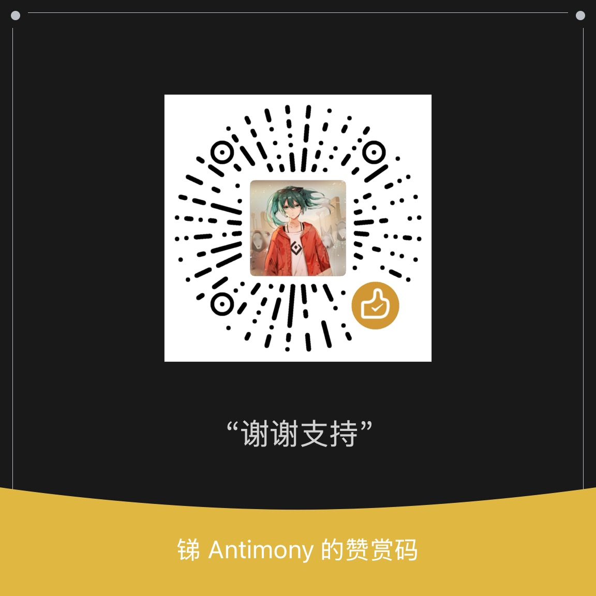

# Hoshi Reader Android

[English](README.md) | **简体中文**

Hoshi Reader Android 是一款面向日语与英语沉浸学习的 EPUB 阅读器，集成 Yomitan 辞典查词、Anki 制卡、有声书跟读和 TTS 朗读，并针对墨水屏优化。

本项目将 [Hoshi Reader](https://github.com/Manhhao/Hoshi-Reader) 带到 Android，提供原生界面和 Android 专属功能。

<table>
  <tr>
    <td></td>
    <td></td>
    <td></td>
    <td></td>
  </tr>
  <tr>
    <td></td>
    <td></td>
    <td></td>
    <td></td>
  </tr>
  <tr>
    <td></td>
    <td></td>
    <td></td>
    <td></td>
  </tr>
</table>

## 功能

### 书架

- 批量或按文件夹递归导入 EPUB，支持自定义书架和 EPUB 导出。
- 封面可显示、模糊或隐藏。
- 将书籍封面设为锁屏壁纸或墨水屏设备屏保。

### 阅读

- 竖排与横排阅读，支持分页、连续滚动和视觉小说（VN）模式。
- 下载或导入字体，自定义排版和振假名显示。
- 全书搜索、章节跳转和音量键翻页。
- 插图画廊与全屏图片查看，支持缩放、保存和分享。

### 查词

- 导入或下载 Yomitan 词条、词频、音调和汉字辞典，支持分类与自动更新。
- 阅读查词、独立辞典搜索、释义内递归查询，以及其他 App 的选词查询。
- 支持日语词形还原和汉字笔顺。
- 词频排序、自定义弹窗样式与 CSS。
- 在线与本地单词发音，可选择用于播放和制卡的录音。

### 配置与外观

- 按语言自动切换或为单本书指定独立的辞典、阅读和 Anki 配置。
- 浅色、深色与自定义主题，全 App 墨水屏适配。

### 标注与统计

- 五色高亮标注，支持跳转、改色和删除。
- 阅读时长、字数和速度统计，支持阅读目标、日历热力图、趋势对比和单书汇总。
- 可编辑阅读记录，并保留已删除书籍的统计。

### Anki 制卡

- 对接 AnkiDroid 和 AnkiConnect，支持多套制卡格式、重复检查和查找已有笔记。
- 内置 [Lapis](https://github.com/donkuri/lapis)、Kiku、Senren 字段预设，可自定义卡片内容和标签。
- 随卡片导出书籍封面、单词音频，以及有声书或 TTS 的句子音频。

### 有声书跟读（Sasayaki）

- 有声书字幕与原文对齐，逐句高亮并自动翻页，支持变速和后台播放。
- 在设备上转写日语有声书，自动生成字幕。

### TTS 朗读

- 系统、在线或自托管语音朗读，支持后台播放、语速调节及旁白/对话分声线。
- 自定义全局或单本书的发音词典，支持正则替换和振假名读音。

### 同步与备份

- 通过 Google Drive 同步书籍和阅读数据，兼容 Hoshi Reader iOS、Hoshi Reader Desktop 与 ッツ Reader。
- 云端书籍按需下载，支持仅删除本地副本。
- 支持 ッツ bookdata 和 `.hoshi` 备份导入/导出。

## 下载 Hoshi Reader Android APK

请从 [GitHub Releases](https://github.com/HuangAntimony/Hoshi-Reader-Android/releases/latest) 下载最新的 Hoshi Reader Android APK。

Hoshi Reader Android 需要 Android 8.0 或更高版本。

## 使用指南

App 交互指南可以参考这篇 Hoshi Reader iOS 使用文档：[Hoshi Reader 使用文档](https://my.feishu.cn/wiki/SXzUw9F6AiPw99kdzwac5Cv8n0f)。

日语学习方法可以参考这篇基于二语习得理论的指南：[基于二语习得理论的日语学习指南](https://my.feishu.cn/wiki/YeOSwsG7giLuQxkcDFscUXVZn2f)。

## 开发状态

项目持续增加阅读功能并改进 Android 使用体验。已发布变化与 Unreleased 中的开发内容见 [docs/CHANGELOG.md](docs/CHANGELOG.md)。

## 功能请求

请在本仓库的 [Issues](https://github.com/HuangAntimony/Hoshi-Reader-Android/issues) 提出建议，并描述你的阅读场景。

## 支持开发

如果 Hoshi 对你的阅读有帮助，欢迎通过 [GitHub Sponsors](https://github.com/sponsors/HuangAntimony)、[Ko-fi](https://ko-fi.com/huangantimony) 或微信赞赏支持开发。

微信赞赏

使用微信扫一扫，或保存图片后在扫一扫中从相册选择。

## 隐私与数据

Hoshi Reader Android 会把导入的书籍、辞典、字体、有声书数据、阅读进度、高亮、统计和设置保存在 App 本地存储中。

Hoshi Google Drive 同步使用 Google Play Services 登录，不可用时使用浏览器 OAuth；TTU 同步使用由用户配置的 Google Cloud OAuth 设备代码流程。两者只请求访问与 App 关联的文件。Anki 制卡会与 AnkiDroid 或已配置的 AnkiConnect 地址通信。在线或自托管 TTS 会将朗读文本发送给所选服务。更新检查会读取 GitHub Release 元数据。

## 鸣谢

Hoshi Reader Android 基于以下生态：

- [Hoshi Reader iOS](https://github.com/Manhhao/Hoshi-Reader)：参考实现。
- [hoshidicts](https://github.com/Manhhao/hoshidicts) 及 [hoshidicts-kotlin-bridge](https://github.com/Manhhao/hoshidicts-kotlin-bridge)：Yomitan 辞典支持。
- [rbook](https://github.com/DevinSterling/rbook)：EPUB 解析，通过 [UniFFI](https://github.com/mozilla/uniffi-rs) 接入。
- [FFmpeg](https://ffmpeg.org/)：有声书原生解码与重采样。
- [Yomitan](https://github.com/yomidevs/yomitan)：辞典格式和查词体验参考。
- [AnkiDroid](https://github.com/ankidroid/Anki-Android)：Android 制卡集成。
- [Ankiconnect Android](https://github.com/KamWithK/AnkiconnectAndroid)：本地音频行为和 AnkiDroid 重复范围 / checksum 查询参考。
- [ッツ Ebook Reader](https://github.com/ttu-ttu/ebook-reader)：阅读器、统计和同步兼容性参考。

## 许可证

本项目基于 GNU General Public License v3.0 发布。详情见 [LICENSE](LICENSE)。

## Star History

如果 Hoshi Reader Android 对你的阅读有帮助，欢迎顺手点一个 Star。

  <picture>
    <source media="(prefers-color-scheme: dark)" srcset="https://api.star-history.com/chart?repos=HuangAntimony/Hoshi-Reader-Android&type=date&theme=dark&legend=top-left" />
    <source media="(prefers-color-scheme: light)" srcset="https://api.star-history.com/chart?repos=HuangAntimony/Hoshi-Reader-Android&type=date&legend=top-left" />
    
  </picture>

